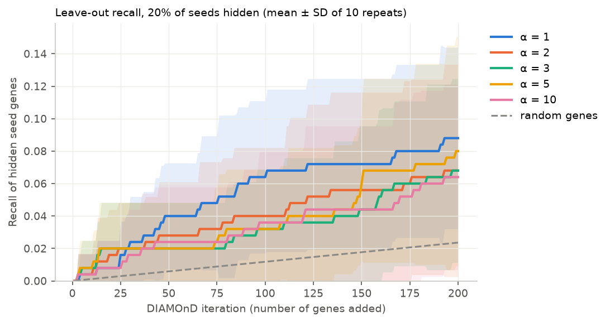
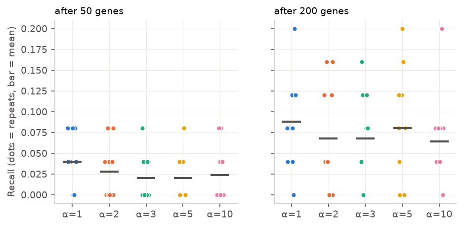
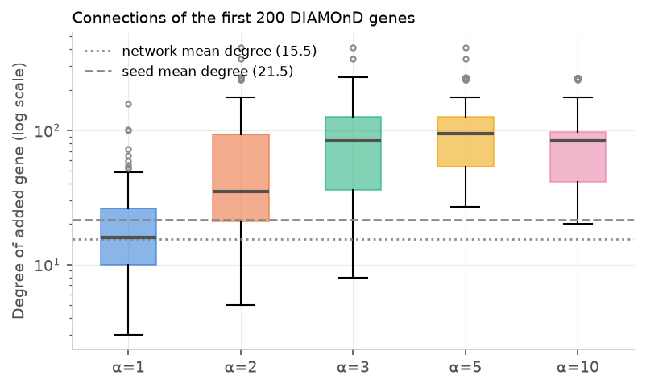
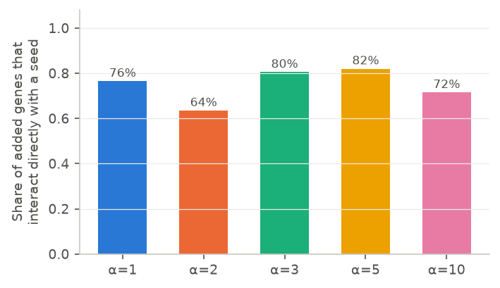
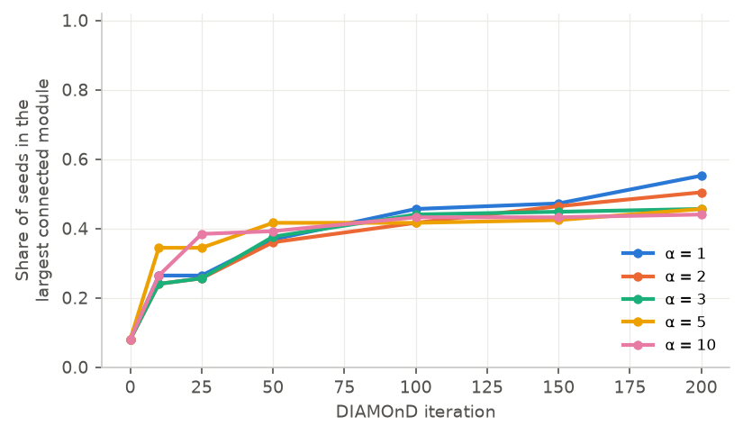
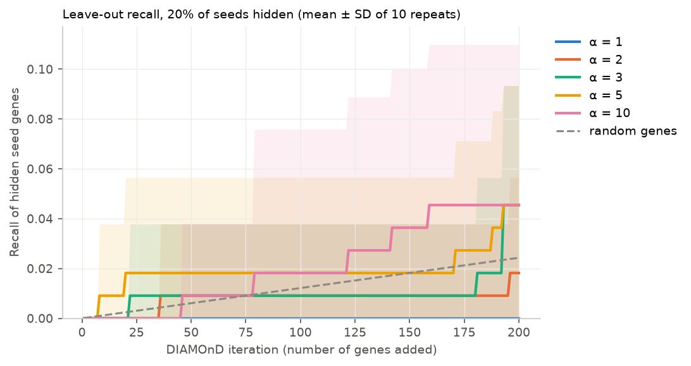
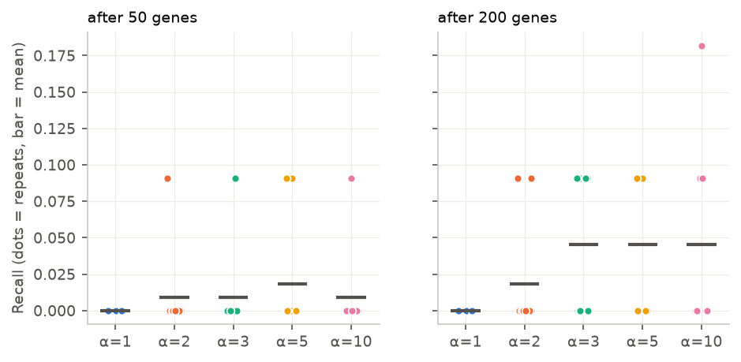
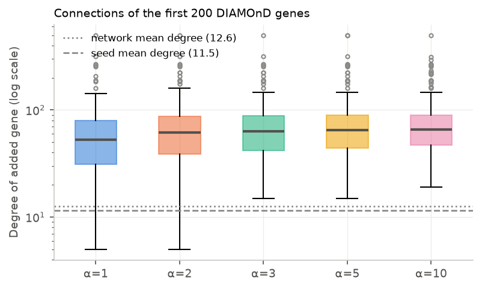
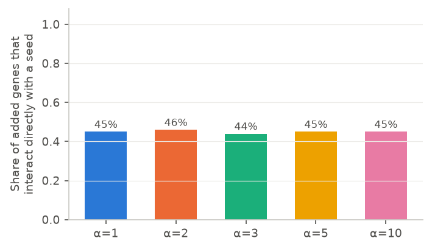
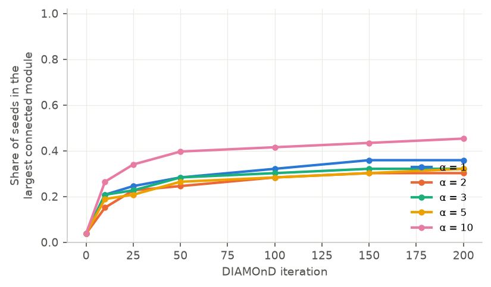

# DIAMOnD seed-weight (α) sweep on a new disease

CB 5313 Systems Biology & Network Modeling: course project.
Paper: Ghiassian, Menche & Barabási (2015). *A DIseAse MOdule Detection (DIAMOnD) algorithm derived from a systematic analysis of connectivity patterns of disease proteins in the human interactome.* PLoS Comput Biol 11(4): e1004120.

## Question

DIAMOnD grows a disease module from known disease genes (seeds) by repeatedly adding the protein whose links to the module are most statistically significant. The paper adds a seed weight **α**, which makes links to the original seeds count α times. It reports that the best α **varies a lot between diseases** (α ≈ 2–3 for some, α ≈ 10 overall) and that its pathway-based validation may favour high α.

**This project asks: for a disease of my choosing, which α recovers known disease genes best, and how does α change the kind of genes DIAMOnD picks?** It also asks whether the answer depends on the interaction network used.

## What is different from the tutorial

The tutorial in the DIAMOnD repository runs `DIAMOnD.py PPI.txt seed_genes.txt 100` on a small example network. This project:

1. **Uses different datasets**: colorectal cancer genes from Open Targets, on two networks: STRING's physical subnetwork (main analysis) and HuRI (comparison). See *Data*.
2. **Sweeps α** over 1, 2, 3, 5 and 10.
3. **Scores each α with the paper's leave-out test** (Fig. 3E–F): hide 20% of the seed genes, run DIAMOnD on the rest, and measure how many hidden genes come back (recall). This is repeated 10 times with different hidden sets, and the same sets are used for every α.
4. **Checks what changes with α**: the degree of the added genes (are hubs let in?), how many touch a seed directly, and how many disconnected seeds get joined into one module.

## Data

| Data | Source | Notes |
|---|---|---|
| Network, main analysis | [STRING v12](https://string-db.org) physical subnetwork, human | Only links with an experimental or curated-database score ≥ 700 (text-mining-only links dropped); gene symbols |
| Network, comparison | [HuRI](http://www.interactome-atlas.org/) (Luck et al., 2020, *Nature*) | Binary interactions from systematic yeast two-hybrid screens; unbiased by literature but sparse; Ensembl gene IDs |
| Disease genes (seeds) | [Open Targets Platform](https://platform.opentargets.org) GraphQL API | Genes with a *genetic association* or *somatic mutation* score ≥ 0.5 for the chosen disease (top 150), similar to the paper's OMIM + GWAS genes |
| DIAMOnD code | [barabasilab/DIAMOnD](https://github.com/barabasilab/DIAMOnD), commit `23e44da` | Downloaded and ported to Python 3 at run time (see *Implementation notes*) |

The disease is colorectal cancer (`MONDO_0005575` in Open Targets), set by `DISEASE_ID` in `config.py`. To change it, search for the disease on platform.opentargets.org and copy its ID from the page URL. The download script warns you if fewer than 20 seed genes are in the network (the paper's minimum).

The network is set by `NETWORK` in `config.py` (`"string"` or `"huri"`). Each network's outputs go to their own folder (`results/string/`, `results/huri/`), so both can be kept.

None of the raw data is committed. `scripts/01_download_data.py` downloads it into `data/`.

## How to run

```bash
# 1. set up the environment (Python 3.10+)
python -m venv .venv
source .venv/bin/activate          # Windows PowerShell: .venv\Scripts\Activate.ps1
pip install -r requirements.txt

# 2. download the network, the disease genes and the DIAMOnD code
python scripts/01_download_data.py

# 3. check the Python 3 port gives the same p-values as SciPy
python -m pytest tests/

# 4. run the experiment and make the figures
python scripts/02_leave_out_sweep.py      # main experiment (runs in parallel)
python scripts/03_module_analysis.py      # properties of the full modules
python scripts/04_make_figures.py         # figures + summary table + README results

# 5. for the comparison, set NETWORK = "huri" in config.py and repeat steps 2 and 4
```

All settings (disease, α values, hidden fraction, repeats, iterations, random seed) are in `config.py`. Every random choice uses `RANDOM_SEED`, so the results are reproducible.

## Repository structure

```
config.py                    all settings
scripts/
  01_download_data.py        downloads the network, Open Targets genes, DIAMOnD.py (+ Python 3 port)
  02_leave_out_sweep.py      leave-out recall for every alpha       -> results/<network>/leave_out_recall.csv
  03_module_analysis.py      seed clustering + module properties   -> results/<network>/module_*.csv, ...
  04_make_figures.py         figures, summary table, README results -> results/<network>/figures/
src/
  port_diamond.py            Python 2 -> 3 conversion of DIAMOnD.py (syntax only)
  utils.py                   loading the network/seeds, running DIAMOnD
tests/
  test_port.py               ported p-value == scipy.stats.hypergeom tail
results/string/, results/huri/   outputs per network (small, committed)
```

## Implementation notes

**Python 3 port.** The original `DIAMOnD.py` is Python 2 and the repository has no licence, so it is downloaded rather than copied here. `src/port_diamond.py` makes syntax-only changes (`print` statements, `iteritems`, `cPickle`, `scipy.infty`). It also changes one bracket so p-values stay plain numbers instead of one-element arrays. The algorithm is unchanged. `tests/test_port.py` checks the p-value against SciPy's hypergeometric distribution.

**How α is implemented in the authors' code.** Reading `diamond_iteration_of_first_X_nodes`, the implementation differs from the paper's description in two ways:

- The paper says α weights links to the **original seeds**. The code multiplies by α the links to **every module member**, including genes DIAMOnD added earlier (`kb` is counted over `cluster_nodes`).
- The number of seeds `s` is scaled by α only before the first iteration. After each addition it is reset to the unweighted module size. So from iteration 2 onwards, links to the module are weighted but the expected number of such links is not.

Both effects make it easier for high-degree genes with several module links to reach a very small p-value. This analysis uses the code as published; the effect is visible in the degree results (Fig. 3).

## Results

### Main analysis: STRING physical network

<!-- RESULTS:string:START -->
Disease: `MONDO_0005575` · network: STRING (physical, exp./database) · 125 seed genes in the network · 20% hidden per repeat · 10 repeats · 200 DIAMOnD genes per run

**Are the seeds clustered?** The seeds' largest connected component has 10 genes, vs 4.7 ± 2.2 for 1000 random gene sets (z = 2.4; the paper counts z > 1.6 as significant).

**Recall of hidden seed genes** (mean ± SD over repeats)

| α | recall@50 | recall@200 |
|---|---|---|
| 1 | 0.04 ± 0.03 | 0.09 ± 0.06 |
| 2 | 0.03 ± 0.03 | 0.07 ± 0.07 |
| 3 | 0.02 ± 0.03 | 0.07 ± 0.06 |
| 5 | 0.02 ± 0.03 | 0.08 ± 0.07 |
| 10 | 0.02 ± 0.03 | 0.06 ± 0.06 |
| random | 0.006 | 0.024 |

**What the 200 added genes look like** (all seeds used). Mean degree: network 15.5, seeds 21.5.

| α | median degree | mean degree | touch a seed directly | seeds in one module (iter 0 → 200) |
|---|---|---|---|---|
| 1 | 16 | 20.6 | 76% | 8% → 55% |
| 2 | 35 | 69.8 | 64% | 8% → 50% |
| 3 | 84 | 93.7 | 80% | 8% → 46% |
| 5 | 94 | 104.2 | 82% | 8% → 46% |
| 10 | 83 | 86.4 | 72% | 8% → 44% |






<!-- RESULTS:string:END -->

### Comparison: HuRI

<!-- RESULTS:huri:START -->
Disease: `MONDO_0005575` · network: HuRI · 53 seed genes in the network · 20% hidden per repeat · 10 repeats · 200 DIAMOnD genes per run

**Are the seeds clustered?** The seeds' largest connected component has 2 genes, vs 2.3 ± 1.2 for 1000 random gene sets (z = -0.3; the paper counts z > 1.6 as significant).

**Recall of hidden seed genes** (mean ± SD over repeats)

| α | recall@50 | recall@200 |
|---|---|---|
| 1 | 0.00 ± 0.00 | 0.00 ± 0.00 |
| 2 | 0.01 ± 0.03 | 0.02 ± 0.04 |
| 3 | 0.01 ± 0.03 | 0.04 ± 0.05 |
| 5 | 0.02 ± 0.04 | 0.04 ± 0.05 |
| 10 | 0.01 ± 0.03 | 0.04 ± 0.06 |
| random | 0.006 | 0.024 |

**What the 200 added genes look like** (all seeds used). Mean degree: network 12.6, seeds 11.5.

| α | median degree | mean degree | touch a seed directly | seeds in one module (iter 0 → 200) |
|---|---|---|---|---|
| 1 | 53 | 64.3 | 45% | 4% → 36% |
| 2 | 62 | 73.1 | 46% | 4% → 30% |
| 3 | 64 | 75.2 | 44% | 4% → 32% |
| 5 | 64 | 80.6 | 45% | 4% → 32% |
| 10 | 66 | 82.7 | 45% | 4% → 45% |






<!-- RESULTS:huri:END -->

### Interpretation

α Comparison:

The value of α = 1 performed best, recall after 200 genes was 0.09 for α = 1 and 0.06–0.08 for the others. The differences between α values (about 0.01–0.03) are smaller than the spread between repeats (SD ≈ 0.06). So, statistically, all α values performed about the same. A higher α was expected to improve recall based on what the paper reports (2-3x better recall when α > 1 on synthetic modules), but that didn't happen on real data. What actually changed α was the type of gene added and not how many correct genes were found:

- At α = 1, the added genes had a median of 16 connections, about the same as an average protein (15.5). So DIAMOnD avoided hubs.
- At α ≥ 3, the median jumped to 83–94 connections. DIAMOnD mostly picked hubs.

A high α pulls hubs because it multiplies links to every gene in the module and not just the original seeds. So, a gene with many links gets a very small p-value and gets pulled. This means at higher α, the method shows hub bias. It picks hubs because they have many connections, and the way α is applied inflates their significance, not because their links to the disease module are actually more significant than expected by chance.
The paper stated DIAMOnD's capability to avoid inflation of significance of hubs as its main advatage. But here it can be seen that a high α value removes that advantage and doesn't improve recall.

Network Comparison 

DIAMOnD worked better than random on STRING (4-7x better), and the share of seeds in one connected module rose from 8% to 55%. The seeds are clustered weakly in STRING (z = 2.4). It is slightly above the paper’s cutoff (z = 1.6), but the paper had z = 15.8 for colorectal cancer which means the genes were highly clustered, that pattern is not seen here. As for HuRI, DIAMOnD performed at a random level. Recall at α = 1 was 0, and the other α values gave 0.02–0.04, the same as random (0.024). The genes are not clustered (z = −0.3), there were only 2 links among 53 seeds. This shows that DIAMOnD assumes disease genes are clustered. On HuRI they weren’t, so DIAMOnD found no more than random guessing, and even at α = 1 it picked hubs, because when the seeds are scattered, hubs are the only genes linked to several of them. This difference may be due to the fact that STRING is built from published studies where most common cancer genes have more known links because they have been studied more (literature/knowledge bias). However, HuRI is unbiased as it is developed using a systematic screen (Y2H method) that tested all proteins in the same way. Thus, one should be careful before trusting the results from literature-based networks.

**Limitations:**
- Recall only measures recovery of *known* disease genes, which are biased towards well-studied genes.
- STRING's experimental and database links come largely from published studies, so well-studied genes (such as famous cancer genes) have more known links. This study bias can make disease genes look more clustered than they are.
- HuRI avoids that bias but is sparse (it covers only a small part of all human interactions), so many seeds are missing or isolated.
- Seeds from GWAS may include false positives (the nearest gene to a variant is not always the causal one).
- The results come from one disease.

## AI use

AI was used to polish the synopsis and condense it to the word limit, generate the implementation codes, draft the README, fact-check the interpretation of the results, and to interpret the content of the paper beyond my understanding. 